# Storage Atlas — distribuição pública e atualização dentro do app

Status: **plano para adoção; não implementado**. Elaborado em 2026-10-30 a partir do código local e das fontes oficiais vinculadas abaixo. Esta etapa não instala dependências, gera chaves, altera a aplicação em execução ou publica nada no GitHub.

## 1. Resultado esperado

Uma pessoa instala o Atlas uma vez. A cada inicialização do processo, o app verifica se existe uma versão compatível mais nova. Quando existir, oferece **Atualizar e reiniciar**. Um clique autoriza baixar, validar, substituir o app e reabri-lo, mantendo índice, preferências e contexto. Sem abrir navegador, baixar instalador manualmente ou arrastar outra cópia nas atualizações normais.

Se houver varredura ativa, a ação passa a ser **Atualizar ao terminar a varredura**. O download pode ocorrer em paralelo, mas a troca e o reinício aguardam sua conclusão. O app não cancela uma leitura longa por causa de uma atualização.

O popup aparece quando há atualização, não em todo lançamento já atualizado. **Mais tarde** dispensa o aviso nesta sessão; uma próxima abertura verifica e pode oferecê-lo novamente. Haverá também **Verificar atualizações…** no menu do app e uma opção pequena para desativar a consulta automática. A preferência será respeitada.

## 2. Arquitetura escolhida

| Parte | Escolha proposta | Responsabilidade |
| --- | --- | --- |
| Código e histórico | Repositório público no GitHub | Código, issues, tags, contribuição e licença |
| Versões distribuídas | GitHub Releases | Artefatos finais associados a uma tag |
| Catálogo de atualização | Appcast estático no GitHub Pages | Informar versões, compatibilidade, download e assinaturas |
| Motor dentro do app | Sparkle 2 | Baixar, verificar e instalar o bundle; coordenar substituição/reabertura |
| Experiência do Atlas | Coordenador + pequena interface nativa | Popup, autorização de um clique, progresso e espera pela varredura |
| Identidade Apple | Developer ID + notarização | Distribuição direta reconhecida pelo macOS |
| Publicação | GitHub Actions em runner macOS | Build, verificações, assinatura, notarização e publicação |

Releases permitem distribuir binários próprios junto de notas e tags; os arquivos automáticos de código-fonte do GitHub não serão o instalador. [GitHub: releases](https://docs.github.com/en/repositories/releasing-projects-on-github/about-releases).

```mermaid
flowchart LR
    A[Tag do mantenedor] --> B[Build e validação]
    B --> C[Assinatura Apple e notarização]
    C --> D[Artefato no GitHub Releases]
    D --> E[Publicar appcast assinado no Pages]
    E --> F[Atlas consulta ao abrir]
    F --> G[Usuário clica Atualizar]
    G --> H[Sparkle baixa e valida]
    H --> I[Aguardar varredura e fechar índice]
    I --> J[Substituir app e reabrir]
```

Sem backend próprio, conta do usuário, token do GitHub embutido, serviço de monitoramento ou acesso remoto ao disco. A nova rede autorizada se limita à distribuição de atualizações. A análise dos arquivos continua local e somente leitura.

### Dependência

Adotar a versão estável **2.10.1** como referência inicial, conferida nesta data; ela exige macOS 12+, compatível com o mínimo atual de macOS 14 do Atlas. Fixar a versão revisada e registrar Package.resolved; reavaliar releases de segurança antes da implementação. O pacote oficial é um binaryTarget com checksum. [Release oficial](https://github.com/sparkle-project/Sparkle/releases/tag/2.10.1), [manifesto SPM](https://github.com/sparkle-project/Sparkle/blob/2.10.1/Package.swift).

Não criar um mecanismo próprio de download/extrair ZIP/sobrescrever o executável em uso. O Atlas deve controlar a experiência e o momento de instalar; Sparkle controla a instalação.

## 3. Ponto de partida e mudanças necessárias

O projeto hoje tem SwiftUI/AppKit, SPM, SQLite em Application Support e empacotamento manual. A build 0.4.2/build 6 é local, ad-hoc e da arquitetura da máquina. Não há Sparkle, feed, assinatura Developer ID, notarização ou workflow de release. Ainda não há repositório Git inicializado nesta cópia, nem licença do projeto na raiz.

O script atual já protege o executável em execução. Esse comportamento continua no build local. A atualização distribuída precisará esperar o processo antigo terminar, em vez de contornar a proteção.

Arquivos previstos, ainda não criados nesta fase:

| Local | Trabalho |
| --- | --- |
| Package.swift / Package.resolved | Dependência oficial fixada; StorageCore continua independente do updater |
| Sources/StorageAtlas/Updates/UpdateController.swift | Uma instância por processo; consulta inicial, menu, estado e preferência |
| Sources/StorageAtlas/Updates/AtlasUpdateUserDriver.swift | Ponte com SPUUserDriver; um clique e apresentação nativa |
| Sources/StorageAtlas/Updates/UpdateView.swift | Popup compacto, progresso, erro e adiamento |
| AppModel.swift / StorageAtlasApp.swift | Integração com ciclo da varredura, contexto e encerramento seguro |
| StorageIndex.swift | Fechamento coordenado, proteção de schema e backup quando necessário |
| Resources/Info.plist | Feed, chave pública e política de consulta/validação |
| scripts/build-app.sh | Preservar modo local; adicionar integração e embedding do framework |
| scripts/release-app.sh | Artefato universal, assinatura, notarização e validações públicas |
| .github/workflows/ci.yml / release.yml | CI de contribuições separada da publicação assinada |
| distribution/ | Configuração pública, preparação do feed e notas; nenhuma chave privada |
| LICENSE / CONTRIBUTING.md / SECURITY.md | Licença escolhida, contribuição e comunicação de falhas |

Como o bundle é montado por script, adicionar Sparkle ao Package.swift não basta. Validar framework em Contents/Frameworks, runpath, symlinks, executáveis auxiliares e assinatura interna. O primeiro marco é abrir a build empacotada fora do diretório de desenvolvimento sem erros de dyld. [Integração oficial](https://sparkle-project.org/documentation/), [assinatura de componentes internos](https://sparkle-project.org/documentation/sandboxing/).

## 4. Fluxo de UX e autorização de um clique

| Situação | Comportamento |
| --- | --- |
| Abrir o app | Mostrar mapa imediatamente; consultar feed em segundo plano, uma vez por processo |
| Nenhuma versão nova | Não abrir popup automático |
| Versão nova, app ocioso | Mostrar versão atual/nova, poucas notas e Atualizar e reiniciar / Mais tarde |
| Versão nova, varredura ativa | Mostrar Atualizar ao terminar a varredura / Mais tarde |
| Usuário aceitou | Baixar e validar; continuar automaticamente com a autorização já dada |
| Aguardando leitura | Mostrar Atualização pronta — aguardando varredura; permitir desistir do agendamento |
| Mais tarde | Continuar trabalho; não repetir popup na mesma sessão |
| Consulta manual sem novidade | Informar que não há atualização compatível disponível |
| Offline na consulta automática | Continuar normalmente; deixar diagnóstico acessível no menu, sem modal repetitivo |
| Falha após aceitar | Mostrar erro útil e Tentar novamente; manter a versão instalada e os dados |
| Rodando de DMG/local sem escrita | Orientar instalação inicial em local adequado, sem elevar privilégios |

Não ocupar a barra da varredura com percentual de download. A atualização terá seu próprio progresso no popup: bytes/percentual apenas quando o tamanho recebido for válido; caso contrário, atividade indeterminada. A tela principal, o treemap e a navegação continuam os mesmos.

### Por que a interface exige uma pequena integração própria

A API de interface do Sparkle separa a oferta da versão e a etapa de instalar/reabrir. Para garantir **um clique total**, o Atlas mantém a autorização da versão escolhida e responde à etapa final automaticamente quando seguro. A interface não refaz validação de assinatura nem implementa um instalador. Desistir antes da instalação revoga essa autorização. [SPUUserDriver, contrato da versão 2.10.1](https://github.com/sparkle-project/Sparkle/blob/2.10.1/Sparkle/SPUUserDriver.h).

Usar o driver padrão no primeiro experimento de integração; a entrega ao usuário só passa no gate quando a ponte própria eliminar a segunda confirmação de reinício. Não prometer um clique apenas por adicionar a dependência.

### Consulta em toda abertura

Criar o updater no ciclo da aplicação, não numa task de cada janela. Depois de iniciar o updater, forçar uma única consulta inicial em background quando a preferência automática estiver habilitada. Consultas manuais usam a API apropriada; não criar timers concorrentes ou um segundo cliente do GitHub. Respeitar sessão em andamento e cancelamento. [SPUUpdater: consulta no lançamento](https://sparkle-project.org/documentation/api-reference/Classes/SPUUpdater.html).

## 5. Preservar varreduras, índice e contexto

Este é um requisito de release, não um acabamento posterior:

1. Download pode ocorrer durante a leitura; instalação e reinício não.
2. Guardar a autorização e a continuação da instalação até o trabalho terminar. A espera deve ser cancelável pelo usuário e não pode ter um timeout que mate a varredura.
3. Ao entrar na fase de instalar, impedir o começo de outra leitura. Tratar a corrida entre fim da leitura, ⌘R e pedido de reinício no mesmo coordenador.
4. Aguardar commit final, persistência de notas e manutenção do índice; cancelar apenas consultas de leitura dispensáveis, fechar conexões e salvar localização/painel/seleção válidos.
5. Só então permitir o encerramento. Sparkle substitui o bundle após a saída e reabre o app no mesmo local.
6. Se o usuário cancelar o encerramento, manter o app funcionando e permitir nova tentativa; não usar kill, exit forçado ou troca de executável vivo.
7. Reabrir o snapshot salvo. Fazer uma atualização não deve obrigar outra varredura global nem apagar o histórico local.

Não confiar apenas no callback shouldPostponeRelaunchForUpdate: a documentação registra situações em que ele não é chamado. Combinar a autorização na etapa final do driver com uma barreira de encerramento da aplicação. Não responder Dismiss nessa etapa supondo que isso impeça instalação ao sair. [Delegação do updater](https://sparkle-project.org/documentation/api-reference/Protocols/SPUUpdaterDelegate.html), [contrato do driver](https://sparkle-project.org/documentation/api-reference/Protocols/SPUUserDriver.html).

### Uma única instância escritora

O StorageIndex atual marca sessões scanning como interrupted ao abrir uma conexão escritora. Portanto, uma segunda instância não pode abrir o índice antes de reconhecer a primeira. Planejar um lock de processo para o diretório de dados, adquirido antes dessa inicialização; uma segunda abertura ativa a janela existente. Leituras readonly de diagnóstico não devem tomar esse papel. Testes usam diretório e identidade separados.

### Migrações

Manter ~/Library/Application Support/StorageAtlas fora do bundle substituído. Preservar esse diretório mesmo se o bundle ID público mudar na primeira versão pública. Migrações devem ser transacionais, reconhecer schema mais novo e não inicializar um banco vazio sobre dados incompatíveis.

Antes de uma migração que exija recuperação, criar backup consistente pelo SQLite, com espaço livre e resultado verificados. Não copiar apenas storage.sqlite enquanto houver WAL ativo. O backup é condicionado à mudança de schema, não a cada atualização de ícone. Limitar retenção e tornar eventual falha explícita. [SQLite Backup API](https://sqlite.org/backup.html).

## 6. Assinaturas, identidade e local de instalação

Para a distribuição pública proposta, usar Developer ID Application, Hardened Runtime e notarização Apple; manter identidade e bundle ID estáveis entre releases. A assinatura ad-hoc de desenvolvimento não é o artefato público. Notarização e stapling entram no pipeline, não são trabalho dos amigos que instalam o app. [Apple: Developer ID e distribuição](https://developer.apple.com/developer-id/).

Há duas confianças diferentes: Apple identifica o app distribuído; a chave Ed25519 do Sparkle autentica a atualização. Apenas a chave pública entra no bundle. Manter chave privada e certificado fora do repositório, com backup recuperável. [Sparkle: segurança das atualizações](https://sparkle-project.org/documentation/).

A garantia de atualização sem senha pressupõe instalação em local gravável pelo usuário. Recomendar **~/Applications/Storage Atlas.app** e oferecer orientação/instalação inicial para a conta quando o app vier de DMG, Downloads ou outro local inadequado. Não codificar o caminho pessoal do mantenedor no instalador. /Applications também pode funcionar, mas não prometer ausência de autorização para instalações pertencentes a outro usuário.

Validar local de instalação e instância escritora antes de criar AppModel/abrir o banco: hoje essa inicialização já pode começar uma varredura. Mover/reabrir uma primeira instalação não pode iniciar dois scanners nem marcar a sessão anterior como interrompida.

Não adicionar helper privilegiado ao Atlas nem elevar o scanner. Se o destino não puder ser atualizado sem elevação, não iniciar a instalação: orientar uma mudança inicial para a pasta de aplicativos do usuário. Esse caso entra no teste com conta não administradora.

### Configuração proposta do Sparkle

| Chave | Política |
| --- | --- |
| SUFeedURL | URL HTTPS estável do appcast no Pages |
| SUPublicEDKey | Chave pública Ed25519 da distribuição |
| SUEnableAutomaticChecks | YES; usuário pode desativar |
| SUAutomaticallyUpdate | NO; atualizar exige o clique do usuário |
| SUEnableSystemProfiling | NO |
| SUVerifyUpdateBeforeExtraction | YES |
| SURequireSignedFeed | YES |
| SUSignedFeedFailureExpirationInterval | 0, sem expirar a rejeição de feed inválido |
| SUEnableJavaScript | NO |

Configuração explícita evita depender de defaults. O bloqueio estrito de feed exige backup da chave; sua perda pode exigir uma nova instalação de bootstrap. Mudanças no feed/notas exigem nova assinatura. [Configuração e requisitos dessas opções](https://sparkle-project.org/documentation/customization/).

A consulta não envia nomes de arquivos, caminhos, categorias, tamanhos, índice ou resultados da varredura. Sem parâmetros personalizados de identificação ou perfil de hardware. GitHub/CDN ainda recebem a conexão HTTP normal, como IP e cabeçalhos; documentar isso sem anunciar que o app inteiro é offline. [Profiling opcional do Sparkle](https://sparkle-project.org/documentation/system-profiling/).

## 7. Artefato e catálogo

- Manter macOS 14 como mínimo inicial.
- Meta de distribuição: bundle universal2, arm64 e x86_64. Se não houver validação Intel, não anunciar suporte Intel como entregue; começar explicitamente com Apple Silicon é uma alternativa.
- Nome instalado fixo: **Storage Atlas.app**. A versão fica nos metadados e no arquivo de download, não no nome do bundle instalado.
- Distribuir um DMG com app assinado/notarizado; o mesmo arquivo pode servir para instalação inicial e para Sparkle. Sem PKG, delta updates ou variantes pagas no MVP.
- Exemplo de arquivo, ainda não publicado: StorageAtlas-v0.5.0-universal.dmg.
- Exemplo ilustrativo de feed: https://OWNER.github.io/REPO/updates/appcast.xml. OWNER/REPO e a URL final ainda precisam ser definidos.
- URLs do download apontam para assets de uma tag exata, não para um arquivo latest substituído a cada publicação.

Gerar o appcast pelas ferramentas oficiais, mantendo versões anteriores compatíveis e incrementando CFBundleVersion globalmente. CFBundleShortVersionString é a versão humana; mínimo de macOS e assinatura ficam no catálogo. Não usar comparação textual de tags nem instalar um build inferior. [Publicação e versionamento Sparkle](https://sparkle-project.org/documentation/publishing/).

A primeira release que os amigos receberem deve **já conter o updater**. As builds locais 0.4.x não podem ganhar essa capacidade remotamente: exigem uma troca manual inicial pela versão de bootstrap. Depois disso, o fluxo normal é dentro do app.

## 8. Publicação de cada versão

Sequência de release proposta:

1. Tag do mantenedor aponta para um commit revisado; validar versão/build e dependências fixadas.
2. Rodar testes e construir as arquiteturas prometidas. Validar executável, framework e auxiliares.
3. Assinar os componentes internos antes do bundle externo, com os entitlements corretos. Não usar assinatura --deep como substituto desse trabalho.
4. Notarizar e staplar o app; preparar o DMG, assiná-lo/notarizá-lo e verificar os tickets e a abertura real.
5. Sobre os bytes finais, gerar a assinatura Sparkle e o appcast. Não alterar o artefato depois de assinado.
6. Criar release draft e anexar DMG, checksums e notas. Verificar o conteúdo antes da publicação.
7. Publicar a release; confirmar que o download público exato está acessível sem login.
8. **Publicar o feed por último**, junto das notas/assinaturas correspondentes. Validar o conteúdo servido, redirects e cache. Em qualquer falha anterior, manter o feed anterior.

Recomendo releases imutáveis: todos os assets entram no draft antes de publicar. Uma correção gera outra versão/build, sem trocar silenciosamente os bytes da versão publicada. [GitHub: releases imutáveis](https://docs.github.com/en/code-security/concepts/supply-chain-security/immutable-releases).

CI de PR não recebe credenciais de assinatura. O workflow de release fica restrito a tags/execuções confiáveis do mantenedor, com permissões mínimas e actions fixadas por SHA. Certificado/P12, senha, credencial de notarização e chave Ed25519 ficam em secrets separados; usar keychain temporário no runner e não exportá-los em logs/caches/artefatos. Clientes não recebem credenciais. [GitHub: segurança de Actions](https://docs.github.com/en/actions/reference/security/secure-use).

## 9. Falhas e recuperação

| Falha | Resultado requerido |
| --- | --- |
| Sem rede, GitHub indisponível ou feed inválido | App instalado continua útil; sem afirmar que está atualizado sem consulta válida |
| Assinatura errada, arquivo truncado ou app adulterado | Rejeitar; não substituir app nem tocar no índice |
| Pouco espaço para download/extração/migração | Explicar necessidade e permitir tentar novamente; não liberar espaço automaticamente |
| macOS/arquitetura incompatível | Oferecer apenas versão compatível, ou explicar o limite na consulta manual |
| Usuário escolhe Mais tarde | Nenhuma instalação sem autorização; próximo lançamento pode lembrar |
| Varredura ou gravação ainda ativa | Aguardar; nunca timeout com encerramento forçado |
| Instalação sem permissão no destino | Orientação de instalação inicial por usuário; nenhuma elevação automática |
| Encerramento recusado | Não travar a interface; retomar/adiar pelo fluxo suportado |
| Migração falha | Preservar original/backup e erro; não apagar o banco para mascarar a falha |
| Release defeituosa | Retirar a oferta do feed e publicar correção com build maior |

Não prometer rollback automático de código e banco após qualquer crash: recuperar schema e executar um binário antigo são coisas diferentes. Uma versão que nem abre pode exigir recuperação manual. O plano cobre esse limite em vez de prometer impossibilidade de reinstalação em um desastre.

## 10. Adoção em fases e gates

| Fase | Entrega | Gate para avançar |
| --- | --- | --- |
| 0 — Identidade pública | Repo/URL, bundle ID definitivo, licença, conta/certificado Apple e chaves | Valores definidos; segredos fora do repo; evidência pessoal removida dos arquivos públicos |
| 1 — Distribuição | Modo local preservado e pacote público assinado/notarizado | Abrir em outro Mac sem SDK, checkout ou ferramentas de desenvolvimento |
| 2 — Motor | Sparkle embarcado, feed de testes e menu manual | Atualização real N → N+1 sem navegador ou substituição manual |
| 3 — UX | Consulta no lançamento, popup de um clique, Mais tarde, progresso/erro | Uma autorização conclui fluxo; ausência de update não interrompe abertura |
| 4 — Trabalho e dados | Barreira da varredura, instância única, shutdown e migração | Atualizar não cancela leitura nem perde índice/contexto |
| 5 — Release CI | Tags, assinatura/notarização e catálogo publicado por último | Uma falha em qualquer job não anuncia artefato incompleto |
| 6 — Piloto | Duas versões consecutivas instaladas por amigos | Primeira instalação e atualização verificadas em máquinas/contas distintas |
| 7 — Open source | Repo e releases públicos com documentação de manutenção | Build de contribuidor funciona sem chaves oficiais; política de release compreensível |

Para amigos antes da abertura do código, usar um repositório de distribuição público apenas com releases/feed e manter o código privado temporariamente. Não embutir token de repositório privado no app. Se puder abrir o código desde o piloto, um único repositório público simplifica tudo. Definir o endereço estável de distribuição antes de entregar o bootstrap.

Antes de tornar o repositório público, revisar screenshots, evidências .impeccable, logs, caminhos pessoais, dados SQLite, artefatos e histórico Git; publicar apenas exemplos sintéticos. Preservar licenças e atribuições de Taste, Sparkle e demais componentes. Licença do projeto: MIT, confirmada pelo autor; LICENSE e THIRD_PARTY_NOTICES.md registram os termos.

## 11. Matriz mínima de aceitação

- [ ] N → N+1 com app realmente distribuído, assinado, notarizado e baixado pelo canal de teste.
- [ ] Popup automático apenas com novidade; Mais tarde volta a ser elegível no próximo lançamento; preferência de consulta respeitada.
- [ ] Um clique percorre download, validação, instalação e reabertura sem outra confirmação de reinício.
- [ ] Varredura longa segue até terminar; concorrer com ⌘R não permite outro writer nem troca durante gravação.
- [ ] Nenhum checkpoint vira interrupted porque outra instância abriu o índice.
- [ ] Snapshot, notas de acesso, filtros/localização válidos e metadados sobrevivem; nenhuma varredura automática causada apenas pela atualização.
- [ ] Offline, feed inválido/adulterado, download interrompido, assinatura errada, arquivo corrompido e disco cheio não danificam a instalação.
- [ ] Mínimo de macOS, versões iguais/antigas e arquiteturas erradas são tratados corretamente.
- [ ] Conta não administradora em ~/Applications atualiza sem senha; destino sem escrita recebe orientação antes de instalar.
- [ ] Rodar de DMG/Downloads/translocation não é confundido com instalação atualizável.
- [ ] Reinício recusado, app fechado durante download e interrupção durante instalação têm recuperação testada.
- [ ] Migração preserva WAL/dados; backup/restauração e schema mais novo testados quando aplicáveis.
- [ ] Popup nativo legível na janela compacta, navegação por teclado e rótulos acessíveis; progresso de update separado da varredura.
- [ ] Verificação de rede confirma ausência de dados do scanner/perfil; build de desenvolvimento/teste não consulta o feed público.
- [ ] Apple Silicon real; Intel real antes de anunciar Intel. Testar permissões de acesso ao disco através de N → N+1 sem prometer que assinatura elimina todo novo pedido do macOS.

Somente depois desses gates registrar a atualização como entregue. Testes de coordenação/migração exigem swift test; empacotamento continua pelo script de build, seguido do fluxo público. Registrar em VERIFICATION.md a máquina, versões N/N+1, identidade de assinatura, feed, preservação do índice e limites observados.

## 12. Definições pendentes antes de implementar/publicar

1. Conta/organização e repositório de distribuição; abrir o código já ou após o piloto.
2. Nome/bundle ID público permanente e estratégia de migração da instalação local.
3. Disponibilidade de Apple Developer Program/certificado e ambiente de assinatura.
4. Licença do projeto e titular do copyright.
5. Necessidade de Intel no primeiro piloto e acesso a uma máquina para validar.

Nenhum desses valores foi inventado ou configurado neste planejamento. Próximo trabalho recomendado: resolver a identidade e fazer o experimento de empacotamento assinado + Sparkle antes de construir o popup definitivo.

### Signing foundation implemented locally — v0.4.6

Pinned certificate-backed local builds and Developer-ID-only distribution packaging gates are implemented; local permission continuity across differently hashed builds is runtime-verified. See docs/SIGNING.md and VERIFICATION.md. Developer ID certificate provisioning, notarization, the updater and public publishing remain pending. Code signing authenticates the app's publisher to macOS; it introduces no Atlas account, sign-in or runtime auth service.
